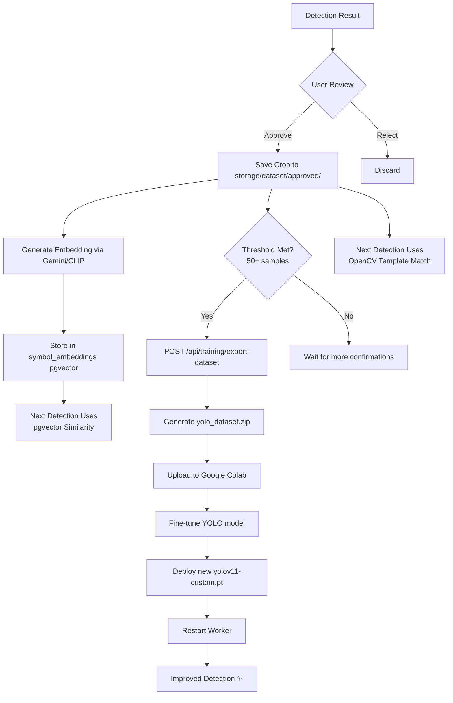

# Ultimate Hybrid Detection Pipeline v4.0

## Arsitektur Multi-Source Detection

```text
DXF Upload
    ↓
┌──────────────────────────────────────────────────────────────┐
│           MULTI-SOURCE DETECTION PIPELINE                    │
├──────────────────────────────────────────────────────────────┤
│                                                              │
│  ┌─────────────────────────────────────────────────────┐   │
│  │ Stage 1: Legend-Based (pgvector Similarity)         │   │
│  │ - Query approved legend symbols                     │   │
│  │ - Cosine similarity search (threshold > 0.85)       │   │
│  │ - Source: storage/legends/symbols/                  │   │
│  └─────────────────────────────────────────────────────┘   │
│                      ↓                                      │
│  ┌─────────────────────────────────────────────────────┐   │
│  │ Stage 2: OpenCV Template Matching                   │   │
│  │ - Load approved detection crops                     │   │
│  │ - Template match: TM_CCOEFF_NORMED                  │   │
│  │ - Source: storage/dataset/approved/                 │   │
│  └─────────────────────────────────────────────────────┘   │
│                      ↓                                      │
│  ┌─────────────────────────────────────────────────────┐   │
│  │ Stage 3: YOLO Tiled Detection                       │   │
│  │ - Multi-scale: 1.0x, 1.5x, 2.0x zoom               │   │
│  │ - Tiling: 1024×1024 with 20% overlap               │   │
│  │ - NMS: IoU > 0.5 deduplication                      │   │
│  │ - Source: services/cv/models/yolo*.pt               │   │
│  └─────────────────────────────────────────────────────┘   │
│                      ↓                                      │
│  ┌─────────────────────────────────────────────────────┐   │
│  │ Stage 4: OCR Text Extraction                        │   │
│  │ - High-res render (3000px)                          │   │
│  │ - EasyOCR + Tesseract dual OCR                      │   │
│  │ - Multi-line text merge                             │   │
│  └─────────────────────────────────────────────────────┘   │
│                                                              │
└──────────────────────────────────────────────────────────────┘
    ↓
┌──────────────────────────────────────────────────────────────┐
│              TAG ASSOCIATION & COORDINATE MAPPING            │
├──────────────────────────────────────────────────────────────┤
│ • Spatial proximity search (adaptive radius)                 │
│ • Pattern validation (legend-driven regex)                   │
│ • Pixel → DXF coordinate transformation                      │
│ • Multi-line tag merge (PSH + P-0201 → PSH P-0201)          │
└──────────────────────────────────────────────────────────────┘
    ↓
┌──────────────────────────────────────────────────────────────┐
│              CONFIDENCE FUSION & FINAL NMS                   │
├──────────────────────────────────────────────────────────────┤
│ • Weighted confidence: source reliability × detection conf   │
│ • Cross-source IoU deduplication (threshold: 0.3)            │
│ • Evidence aggregation from all sources                      │
└──────────────────────────────────────────────────────────────┘
    ↓
┌──────────────────────────────────────────────────────────────┐
│                   USER REVIEW & APPROVAL                     │
└──────────────────────────────────────────────────────────────┘
    ↓
┌──────────────────────────────────────────────────────────────┐
│              CONTINUOUS LEARNING STORAGE                     │
├──────────────────────────────────────────────────────────────┤
│ 1. Crop Storage: storage/dataset/approved/                   │
│    Format: [tag]_[type]_conf[score].png                     │
│                                                              │
│ 2. pgvector Embedding: symbol_embeddings table               │
│    - Vector dimension: 768 (Gemini / CLIP)                   │
│    - Cosine similarity index                                 │
│                                                              │
│ 3. YOLO Training Dataset: yolo_dataset.zip                   │
│    - Auto-export when threshold reached (50+ samples)        │
│    - Format: images/train + labels/train (YOLO txt)          │
│                                                              │
│ 4. Training Loop:                                            │
│    Approved detection → storage + pgvector                   │
│    → Re-train YOLO → Deploy new model                        │
│    → Improved detection accuracy ✨                          │
└──────────────────────────────────────────────────────────────┘
```

---

## Implementasi Detail

### File Structure

```
lib/detection/multi-source/
├── legend-detector.ts       # pgvector similarity search
├── opencv-detector.ts       # Template matching dari approved crops
├── yolo-tiled-detector.ts   # Multi-scale tiled YOLO detection
└── ocr-extractor.ts         # OCR text extraction

workers/
└── detection-worker.ts      # Orchestrator pipeline

storage/
├── dataset/
│   ├── approved/            # User-approved detection crops
│   │   ├── P-101_Pump_conf0.92.png
│   │   ├── V-203_Vessel_conf0.88.png
│   │   └── ...
│   └── training/            # YOLO training dataset (auto-generated)
├── legends/
│   └── symbols/             # Legend symbol crops dengan embeddings
└── pages/                   # Rendered DXF pages untuk detection
```

### Database Schema

```sql
-- Existing tables
symbol_embeddings (
  id UUID,
  project_id UUID,
  asset_type TEXT,
  embedding vector(768),       -- pgvector embedding
  canonical_features TEXT,
  confirmed_count INT,
  crop_hash TEXT
);

-- New tracking
detections (
  ...existing columns...
  detection_source TEXT,         -- 'LEGEND' | 'OPENCV' | 'YOLO' | 'OCR'
  dxf_coordinates JSONB,         -- {x: float, y: float} koordinat DXF asli
  scale FLOAT,                   -- Zoom level detection occurred (1.0, 1.5, 2.0)
  tile_id TEXT                   -- Tile identifier untuk debugging
);
```

---

## Koordinat Mapping

### Pixel Space → DXF World Space

```typescript
function pixelToDxfCoords(
  pixelX: number,
  pixelY: number,
  imageWidth: number,
  imageHeight: number,
  extents: { minX, minY, maxX, maxY }
): { x: number; y: number } {
  // Linear transformation
  const dxfX = extents.minX + (pixelX / imageWidth) * (extents.maxX - extents.minX);
  const dxfY = extents.maxY - (pixelY / imageHeight) * (extents.maxY - extents.minY); // flip Y
  
  return { x: dxfX, y: dxfY };
}
```

**Contoh:**
- DXF extents: `minX=0, minY=0, maxX=1000, maxY=800`
- Image size: `2400×1920 px`
- Detection bbox center: `(600px, 480px)`
- **DXF coords:** `(250, 600)` ✅

---

## Tiling Strategy

### Problem: Komponen Kecil Hilang pada Full Image

**Solusi:** Split image ke tiles 1024×1024 dengan overlap

```
Original: 2400×1920 px
           ↓
┌──────────────────────────┐
│ Tile 0   │ Tile 1        │  Overlap 20%
│ 0,0      │ 819,0         │  = 204px horizontal
├──────────┼───────────────┤
│ Tile 2   │ Tile 3        │
│ 0,768    │ 819,768       │
└──────────┴───────────────┘

Each tile: 1024×1024 px
Stride: 1024 × (1 - 0.2) = 819px
```

### Multi-Scale Detection

```
Scale 1.0x: 2400px width  → deteksi komponen normal
Scale 1.5x: 3600px width  → deteksi komponen kecil
Scale 2.0x: 4800px width  → deteksi detail intricate
```

**NMS:** Deduplicate detections across scales (IoU > 0.5)

---

## Confidence Fusion

### Source Weights

| Source | Base Weight | Reason |
|--------|-------------|--------|
| LEGEND | **1.0** | Highest trust (user-approved embeddings) |
| OPENCV | **0.95** | High trust (approved template crops) |
| YOLO | **0.9** | Trained model (may have false positives) |
| OCR | **0.7** | Text only (needs symbol association) |

### Final Confidence Formula

```
finalConf = sourceWeight × detectionConf × tagBonus

Where:
- sourceWeight = 1.0 (LEGEND) | 0.95 (OPENCV) | 0.9 (YOLO) | 0.7 (OCR)
- detectionConf = 0.0 - 1.0 (model confidence)
- tagBonus = 1.0 + (0.3 × tagMatchConf) if tag found, else 1.0
```

**Example:**
```
YOLO detection: 0.88
Source: YOLO (weight 0.9)
Tag found: "P-101" (tagMatchConf: 0.95)

finalConf = 0.9 × 0.88 × (1.0 + 0.3 × 0.95)
          = 0.9 × 0.88 × 1.285
          = 0.909  ← High confidence! ✅
```

---

## Learning Loop Workflow



---

## Python CV Service Endpoints

### Required Endpoints

```python
# services/cv/app.py

@app.post("/template-match")
async def template_match(
    image: str,          # base64 PNG
    template: str,       # base64 PNG
    threshold: float,    # 0.8
    method: str          # 'TM_CCOEFF_NORMED'
) -> dict:
    # OpenCV template matching
    return {
        "matches": [
            {"x": 100, "y": 200, "confidence": 0.92}
        ]
    }

@app.post("/yolo-detect")
async def yolo_detect(
    image: str,              # base64 PNG (1024×1024)
    conf_threshold: float    # 0.5
) -> dict:
    # YOLO inference
    return {
        "detections": [
            {
                "class_id": 0,
                "class_name": "centrifugal_pump",
                "confidence": 0.88,
                "bbox": {"x": 100, "y": 150, "w": 80, "h": 120}
            }
        ]
    }

@app.post("/ocr")
async def ocr_extract(
    image: str,     # base64 PNG
    lang: str       # 'en'
) -> dict:
    # EasyOCR + Tesseract
    return {
        "texts": [
            {
                "text": "P-101",
                "bbox": {"x": 50, "y": 30, "w": 60, "h": 20},
                "confidence": 0.95
            }
        ]
    }

@app.post("/embedding")
async def generate_embedding(
    image: str      # base64 PNG crop
) -> dict:
    # CLIP / Gemini vision embedding
    return {
        "embedding": [0.123, -0.456, ...],  # 768-dim vector
        "model": "clip-vit-b32"
    }
```

---

## Monitoring & Debugging

### Detection Logs

```sql
-- Check detection source distribution
SELECT 
  detection_source, 
  COUNT(*) as count,
  AVG(confidence) as avg_conf
FROM detections
WHERE job_id = '<job_id>'
GROUP BY detection_source;

-- Check multi-scale detections
SELECT 
  scale,
  COUNT(*) as count,
  AVG(confidence) as avg_conf
FROM detections
WHERE detection_source = 'YOLO'
  AND scale IS NOT NULL
GROUP BY scale
ORDER BY scale;
```

### Performance Metrics

| Stage | Expected Time | Notes |
|-------|---------------|-------|
| Legend matching | 2-5s | Fast (pgvector index) |
| OpenCV template | 5-10s | Depends on template count |
| YOLO tiled (3 scales) | 15-30s | GPU required |
| OCR extraction | 3-8s | High-res render |
| **Total** | **25-53s** | Per region/sheet |

---

## Next Steps

1. ✅ **Architecture designed** — Multi-source pipeline defined
2. ✅ **Modules created** — legend, opencv, yolo-tiled, ocr detectors
3. ⏳ **Python endpoints** — Implement CV service REST API
4. ⏳ **Worker integration** — Connect modules to detection pipeline
5. ⏳ **Coordinate mapping test** — Verify pixel→DXF accuracy
6. ⏳ **Storage setup** — Create approved crops directory structure
7. ⏳ **End-to-end test** — Upload complex DXF → verify all sources
8. ⏳ **Learning loop** — Confirm → storage → pgvector → retrain

---

**Created:** 2026-11-05  
**Version:** 4.0 Ultimate Hybrid  
**Status:** Architecture implemented, endpoints pending
